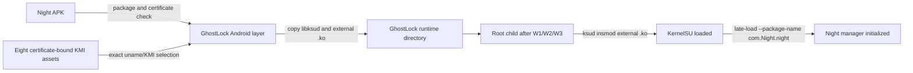

English | [简体中文](night-upstream-sync-plan_ZH.md)

# Night upstream synchronization plan (2026-10-29)

## Current state and baseline

- Customized branch: `main` at `a96a76ad4e34bc919b47eddb07bd35b46573d88a`.
- Authoritative upstream: `YuKongA/ghostlock-app` `main` at `437b3b2`.
- Night branch: `wutong7891/KernelSU` `night` at `51d6b782`; the current KMI payloads come from KernelSU source commit `836fa803`.
- The customized branch is 7 commits ahead of and 481 commits behind upstream.
- The current Night APK contains no `.ko` ZIP entry, and none of its three `libksud.so` binaries contains an embedded Night KMI filename.

## Goals and constraints

- Merge the current upstream history without rewriting the published customized history.
- Preserve Night-only package and signing-certificate binding.
- Keep exactly eight current certificate-bound KMI modules in GhostLock, not in the Night Manager APK.
- Load the selected external module with Night's `ksud insmod`, then complete initialization with `late-load --package-name com.Night.night`.
- Reject a missing Night installation, certificate mismatch, unsupported KMI, missing module, or missing `libksud.so`; do not fall back to another manager.
- Do not change route selection, profile format, waiter/race/payload behavior, or device support claims.
- Do not run a device gate because the user explicitly prohibited phone testing. Report the resulting runtime uncertainty.

## Change list

- Merge `upstream/main` into the integration branch and resolve only Night customization conflicts.
- `app/src/main/AndroidManifest.xml`: retain visibility of `com.Night.night`.
- `app/src/main/kotlin/com/ghostlock/app/data/ManagerScanner.kt`: make Night the accepted manager and keep resolution testable.
- `app/src/main/kotlin/com/ghostlock/app/data/AndroidGhostlockRepository.kt`: verify the Night signing certificate, select the exact KMI asset, copy Night `libksud.so`, and prepare the external module.
- `src/core/attack/ops.cpp`: replace generic embedded-KMI late-load with external Night `insmod`, followed by Night package initialization, without modifying W1/W2/W3 or route logic.
- `app/src/test/**`: cover Night manager selection and rejection behavior.
- `app/src/main/assets/night-kmi/<certificate-sha256>/*.ko`: retain exactly eight current Night modules.
- `README.md`, `README_ZH.md`, and `NIGHT_COMPAT.md`: describe the current Night-only flow and its verification limits.
- `app/build.gradle.kts`: advance the Night compatibility version.

## Data-flow/control-flow differences

The upstream attack state machine remains `setup -> W1 -> W2 -> W3 -> handoff`. Only the handoff's module source and manager identity change. The Kotlin layer remains the authority for package, certificate, and KMI selection; the native layer consumes prepared paths and does not select a different manager.

## Compatibility and rollback

- Compatibility is limited to `com.Night.night` signed by the configured Night certificate and the eight published KMI variants.
- The merge commit preserves both histories. Roll back by reverting the merge/adaptation commits or by returning to `a96a76a`.
- The previous built APK remains a recovery artifact until the new APK passes static and GitHub Actions verification.

## Verification matrix

| Batch | Verification | Expected result |
|---|---|---|
| Upstream merge | `make -C src native-host-tests` | All host tests pass |
| Upstream merge | `./gradlew :app:testDebugUnitTest` | All Kotlin tests pass |
| Upstream merge | `(cd tools/extract_rs && cargo test --release)` | All Rust tests pass |
| Native | NDK build and `make -C src lint-tidy` | Zero warnings and zero findings |
| Attack-shape guard | `tools/cmp_disasm.py` against the upstream baseline | Eight protected functions identical or reviewed annotations |
| Night assets | Hash every APK KMI against `dist-night/kmi` | Exactly eight matches |
| GhostLock APK | Inspect ZIP, signing block, DEX markers, and native libraries | Night package/certificate markers, two required native libraries, eight KMI assets |
| Night Manager APK | Inspect ZIP and all `libksud.so` binaries | No `.ko` entries and no embedded KMI filename markers |
| GitHub Actions | Build workflow on `main` | APK job succeeds and artifact is downloaded and rechecked |
| Device gate | Not run by user instruction | Mark runtime behavior device-unverified |

## Explicit preservation

- Preserve `kernelsnitch/`, `LegacyProfileConverter.kt`, GLK1 v2, the component catalog, route policies, profiles, and all upstream device evidence unchanged.
- Preserve the eight upstream attack-function shapes.
- Do not add generic-manager fallback, package-name-only trust, a new profile format, or a new route.
- Do not modify Night signing keys or retain any private key locally.

## Progress

- [x] Identify upstream and baselines.
- [x] Verify the current Night Manager APK has no bundled KMI.
- [x] Merge upstream on an integration branch.
- [x] Reapply the Night-only compatibility layer.
- [x] Attempt local verification (blocked by missing local JDK, Cargo, and native build tools; GitHub Actions is the authoritative build gate).
- [ ] Build with GitHub Actions and inspect the artifact.
- [x] Record the device gate as not run by user instruction.
