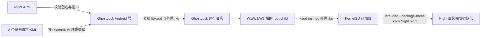

[English](night-upstream-sync-plan.md) | 简体中文

# Night 上游同步计划（2026-10-29）

## 当前状态与基线

- 定制分支：`main`，提交 `a96a76ad4e34bc919b47eddb07bd35b46573d88a`。
- 权威上游：`YuKongA/ghostlock-app` 的 `main`，提交 `437b3b2`。
- Night 分支：`wutong7891/KernelSU` 的 `night`，提交 `51d6b782`；当前 KMI 来自 KernelSU 源码提交 `836fa803`。
- 定制分支领先上游 7 个提交、落后上游 481 个提交。
- 当前 Night APK 没有 `.ko` ZIP 条目，三个 `libksud.so` 也都不含 Night KMI 文件名标记。

## 目标与约束

- 合并当前上游历史，不重写已发布的定制历史。
- 保留 Night 专属包名与签名证书绑定。
- GhostLock 保留且仅保留 8 个当前证书绑定 KMI；Night 面具 APK 不内置 KMI。
- 使用 Night 的 `ksud insmod` 加载选定的外置模块，再执行 `late-load --package-name com.Night.night` 完成初始化。
- Night 未安装、证书不符、KMI 不支持、模块缺失或 `libksud.so` 缺失时必须拒绝执行；不得回退其他面具。
- 不修改 route 选择、profile 格式、waiter/race/payload 行为或设备支持声明。
- 用户明确禁止手机测试，因此不运行真机 gate，并明确报告运行时不确定性。

## 改动清单

- 将 `upstream/main` 合并到集成分支，只解决 Night 定制冲突。
- `app/src/main/AndroidManifest.xml`：保留对 `com.Night.night` 的可见性。
- `app/src/main/kotlin/com/ghostlock/app/data/ManagerScanner.kt`：仅接受 Night，并保持解析逻辑可测试。
- `app/src/main/kotlin/com/ghostlock/app/data/AndroidGhostlockRepository.kt`：验证 Night 签名证书、选择精确 KMI、复制 Night `libksud.so` 并准备外置模块。
- `src/core/attack/ops.cpp`：把通用内置 KMI late-load 改成外置 Night `insmod`，然后初始化 Night 包；不修改 W1/W2/W3 或 route 逻辑。
- `app/src/test/**`：覆盖 Night 管理器选择与拒绝行为。
- `app/src/main/assets/night-kmi/<certificate-sha256>/*.ko`：只保留 8 个当前 Night 模块。
- `README.md`、`README_ZH.md`、`NIGHT_COMPAT.md`：说明当前 Night 专属流程与验证限制。
- `app/build.gradle.kts`：提升 Night 兼容版本。

## 数据流与控制流差异

上游攻击状态机仍为 `setup -> W1 -> W2 -> W3 -> handoff`。只改变 handoff 的模块来源和管理器身份。Kotlin 层继续负责包名、证书和 KMI 选择；native 层只消费已准备的路径，不得选择其他管理器。

## 兼容性与回滚

- 兼容范围仅限由指定 Night 证书签名的 `com.Night.night`，以及已发布的 8 个 KMI 变体。
- merge commit 保留两边历史。可以 revert 合并/适配提交，或返回 `a96a76a`。
- 新 APK 通过静态检查和 GitHub Actions 验证前，保留上一版 APK 作为恢复产物。

## 验证矩阵

| 批次 | 验证 | 预期结果 |
|---|---|---|
| 上游合并 | `make -C src native-host-tests` | 所有主机测试通过 |
| 上游合并 | `./gradlew :app:testDebugUnitTest` | 所有 Kotlin 测试通过 |
| 上游合并 | `(cd tools/extract_rs && cargo test --release)` | 所有 Rust 测试通过 |
| Native | NDK 构建与 `make -C src lint-tidy` | 零告警、零 findings |
| 攻击形状门禁 | 使用 `tools/cmp_disasm.py` 对比上游基线 | 8 个受保护函数相同，或差异已复核记录 |
| Night 资源 | 将 APK 内每个 KMI 与 `dist-night/kmi` 做哈希比对 | 恰好 8 个且全部一致 |
| GhostLock APK | 检查 ZIP、签名块、DEX 标记和 native 库 | 含 Night 包名/证书标记、两个所需 native 库、8 个 KMI |
| Night 面具 APK | 检查 ZIP 以及所有 `libksud.so` | 没有 `.ko` 条目，也没有内置 KMI 文件名标记 |
| GitHub Actions | 在 `main` 运行 Build workflow | APK job 成功，下载产物后再次检查 |
| 真机 gate | 按用户要求不执行 | 标记运行时未经真机验证 |

## 明确保留

- 不改 `kernelsnitch/`、`LegacyProfileConverter.kt`、GLK1 v2、组件目录、route policy、profile 与所有上游设备证据。
- 保持 8 个上游攻击函数的机器码形状。
- 不增加通用管理器回退、仅包名信任、新 profile 格式或新 route。
- 不修改 Night 签名密钥，也不在本地保留任何私钥。

## 进度

- [x] 确认上游与基线。
- [x] 验证当前 Night 面具 APK 未内置 KMI。
- [x] 在集成分支合并上游。
- [x] 重新应用 Night 专属兼容层。
- [x] 已尝试本地验证（本机缺少 JDK、Cargo 和原生构建工具；以 GitHub Actions 为最终构建门禁）。
- [ ] 使用 GitHub Actions 构建并检查产物。
- [x] 按用户要求记录为未执行真机 gate。
